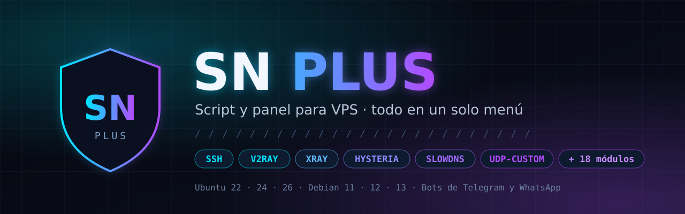

<div align="center">



<br>

[](https://wiki.snplus.sinnombre.xyz)
[](https://t.me/SN_PLUS)
[](#-compatibilidad)
[](#-compatibilidad)


**Script VPS en español para instalar y administrar SSH, V2Ray, Xray, Hysteria, SlowDNS, UDP-Custom y más desde un solo menú.**
Hecho en C++ · rápido · con bots de Telegram y WhatsApp para manejar tus usuarios desde el celular.

[🌐 Página web](https://wiki.snplus.sinnombre.xyz) · [Instalar](#-instalación) · [Protocolos](#-protocolos-y-servicios) · [Usuarios](#-administración-de-usuarios) · [Bots](#-bots) · [Herramientas](#-herramientas) · [Licencia](#-licencia) · [Grupo](#-comunidad-y-soporte)

</div>

---

## ⚡ Instalación

Entra a tu VPS como **root** y pega:

```bash
rm -rf /root/install.sh && wget --no-cache -O /root/install.sh https://raw.githubusercontent.com/SINNOMBRE22/SNPLUS/main/install.sh && chmod +x /root/install.sh && /root/install.sh
```

1. El instalador detecta tu sistema, prepara la VPS y te pide tu **key de activación**.
2. Al terminar escribe **`menu`** para abrir el panel.

> [!TIP]
> Usa una VPS **recién instalada** (Ubuntu o Debian limpio) para evitar choques con otros scripts.
> Si algo falla, el registro completo queda en `/var/log/snplus_install.log`.

---

## 🛡️ Qué es SN PLUS

SN PLUS es un **script/panel para VPS** que convierte un servidor Linux en un servidor de túneles y VPN listo para vender o usar: instalas protocolos con un número, creas usuarios en segundos y ves todo (puertos, conexiones, consumo) desde un menú claro en la terminal.

- **Hecho en C++**, no en Bash: abre al instante y consume muy poco.
- **Todo en un menú:** protocolos, usuarios, puertos, banner, bots y herramientas.
- **Los protocolos UDP conviven sin pisarse:** Hysteria, ZivVPN y UDP-Custom funcionan a la vez, cada uno en su rango, y las reglas sobreviven a reinicios.
- **Panel web propio:** administra usuarios, protocolos y respaldos desde el navegador, con HTTPS y acceso solo para el dueño de la VPS.
- **Bots de Telegram y WhatsApp** para que tú y tus revendedores manejen cuentas desde el celular.
- **Se actualiza desde el propio menú** (opción `101`).
- **5 idiomas:** español, inglés, portugués, ruso y árabe.

---

## 🔌 Protocolos y servicios

Menú **Instaladores** — cada opción muestra si está activa y en qué puerto:

| # | Servicio | Para qué sirve |
|:--:|:--|:--|
| 01 | **SSH** | Ajustes del servidor SSH y puertos |
| 02 | **Dropbear** | SSH ligero en puertos extra |
| 03 | **Stunnel (SSL)** | SSH sobre SSL/TLS |
| 04 | **SOCKS (Python)** | Proxy SOCKS / directo |
| 05 | **WebSocket WS** | SSH sobre WebSocket |
| 06 | **HCR Tunnel** | Túnel HCR |
| 07 | **BHTTP-SN** | Túnel BHTTP |
| 08 | **BadVPN-UDPGW** | UDP para juegos y llamadas sobre SSH |
| 09 | **UDP-Custom** | Conexiones UDP Custom |
| 10 | **V2Ray** | VMess |
| 11 | **Xray MOD** | Xray con VLESS y VMess |
| 12 | **Hysteria** | Hysteria v1 y v2 (UDP de alta velocidad) |
| 13 | **ZivVPN** | ZIV / ZIP-UDP |
| 14 | **SlowDNS** | Túnel por DNS (DNSTT) |
| 15 | **Shadowsocks** | Proxy Shadowsocks |
| 16 | **Slipstream** | Túnel DNS/QUIC (app SlipNet) |
| 17 | **Squid Proxy** | Proxy HTTP |
| 18 | **Psiphon** | Servidor Psiphon |
| 19 | **AdBlock** | Bloqueo de publicidad y rastreadores |
| 20 | **Certificado SSL** | Gestión de certificados |
| 21 | **Subdominio** | Asignar subdominio a la VPS |

---

## 👥 Administración de usuarios

<table>
<tr>
<td valign="top" width="33%">

**🔐 SSH**
- Crear, renovar y eliminar
- Límite de conexiones por usuario
- Limitador de cuentas y de expirados
- Horarios programados
- Monitor de conectados y consumo
- Borrar vencidos en un paso

</td>
<td valign="top" width="33%">

**🔴 V2Ray (VMess)**
- Crear, renovar y eliminar
- Bloquear / desbloquear
- Ver datos y link VMess
- Copias de seguridad

</td>
<td valign="top" width="33%">

**🟣 Xray MOD (VLESS / VMess)**
- Crear, renovar y eliminar
- Bloquear / desbloquear
- Links listos para copiar
- Estadísticas de tráfico
- Copias de seguridad

</td>
</tr>
</table>

Cada usuario tiene una **tarjeta** con todo lo que necesita para conectarse: puertos de cada protocolo activo, rango de Hysteria real y links.

**💾 Respaldo de usuarios:** guarda tus usuarios SSH, V2Ray y Xray en `/root` y restáuralos en otra VPS en segundos, con las mismas claves, fechas, límites y UUID (tus clientes no cambian nada).

---

## 🤖 Bots

<table>
<tr>
<td valign="top" width="50%">

**Bot de Telegram**
- Crear / eliminar usuarios SSH
- Cuentas de prueba por horas
- Ver usuarios en línea y buscar
- Editar contraseña, límite y fecha
- Eliminar expirados
- **Revendedores** con o sin límite
- `/info` del sistema y `/speedtest`

</td>
<td valign="top" width="50%">

**Bot de WhatsApp**
- Se vincula por **QR** o por **código**
- Números administradores
- Prefijo de comandos configurable
- Ver estado y logs desde el menú

</td>
</tr>
</table>

---

## 🧰 Herramientas

| | | |
|:--|:--|:--|
| 🚀 Optimizador de VPS | 📊 Speedtest y Speed Net | 💾 Gestión de SWAP |
| 🌐 Gestión de DNS | 🔎 Subscan (buscar dominios / SNI) | 🖥️ Panel web |
| 🚫 Bloqueo de torrent | 🧭 IP Info | 🕒 Zona horaria |
| 🌍 Idioma / Language | 🔑 Cambiar contraseña root | 🧹 Limpiar caché |
| 🔄 Reiniciar servicios | ⬆️ Actualizar sistema | 🏷️ Configurar dominio |
| 💾 Respaldo de usuarios | | |

**Sistema:** administrador de puertos con buscador, banner SSH estático o dinámico, actualizador del script, reinicio y desinstalación desde el menú.

---

## 💻 Compatibilidad

| Sistema | Versiones |
|:--|:--|
| **Ubuntu** | 22.04 · 24.04 · 26.04 |
| **Debian** | 11 · 12 · 13 |

Arquitectura **x86_64 (amd64)**. Funciona en cualquier proveedor de VPS (DigitalOcean, Vultr, Contabo, Hetzner, Oracle, AWS, Google Cloud, etc.).

---

## 🔑 Licencia

SN PLUS se activa con una **key** durante la instalación; la key queda vinculada a la IP de tu VPS.

<div align="center">

[](https://t.me/SinNombreNET)
[](https://wa.me/5215629885039)

</div>

---

## 💬 Comunidad y soporte

Novedades, ayuda con la instalación y actualizaciones en el **grupo de Telegram** y en la **página web**:

<div align="center">

[](https://t.me/SN_PLUS)
[](https://wiki.snplus.sinnombre.xyz)

</div>

---

## ❓ Preguntas frecuentes

<details>
<summary><b>¿Qué es un script VPS?</b></summary>

Es un programa que se instala en tu servidor y te deja configurar protocolos (SSH, V2Ray, Hysteria, SlowDNS…) y crear usuarios sin tener que escribir comandos de Linux a mano. SN PLUS hace todo eso desde un menú con números.
</details>

<details>
<summary><b>¿Funciona en Ubuntu 24.04 y Debian 12?</b></summary>

Sí. Está probado en Ubuntu 22.04, 24.04 y 26.04, y en Debian 11, 12 y 13.
</details>

<details>
<summary><b>¿Puedo usar Hysteria, ZivVPN y UDP-Custom al mismo tiempo?</b></summary>

Sí. SN PLUS reparte los puertos UDP entre ellos (Hysteria 20000-39999, ZivVPN 6000-19999 y UDP-Custom el resto) y las reglas se mantienen después de reiniciar la VPS.
</details>

<details>
<summary><b>¿Cómo actualizo SN PLUS?</b></summary>

Escribe `menu` y elige la opción **101 · Actualizar script**.
</details>

<details>
<summary><b>¿Puedo vender cuentas con revendedores?</b></summary>

Sí. Desde el bot de Telegram agregas revendedores con o sin límite, y ellos crean sus cuentas desde su celular.
</details>

---

<div align="center">

**🛡️ SN PLUS — Simple · Directo · Potente**

[Página web](https://wiki.snplus.sinnombre.xyz) · [Novedades](CHANGELOG.md) · [Grupo de Telegram](https://t.me/SN_PLUS) · [Soporte](https://t.me/SinNombreNET)

<sub>© 2026 SinNombre · SINNOMBRE22</sub>

</div>
